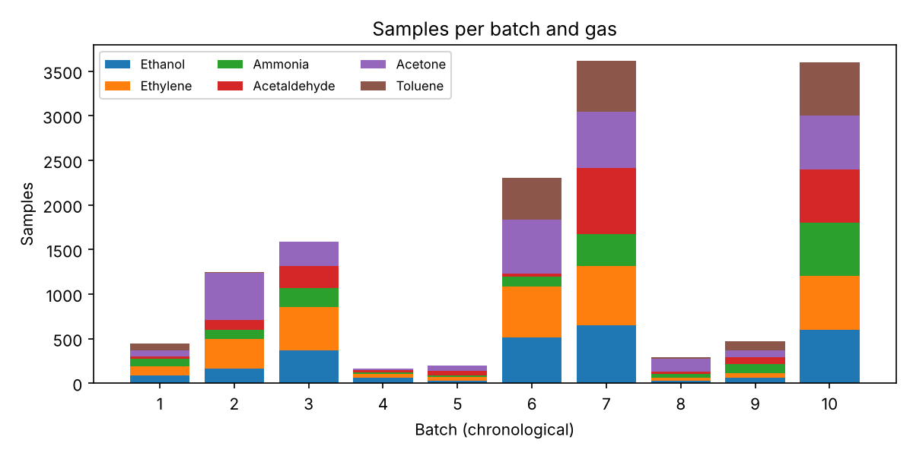
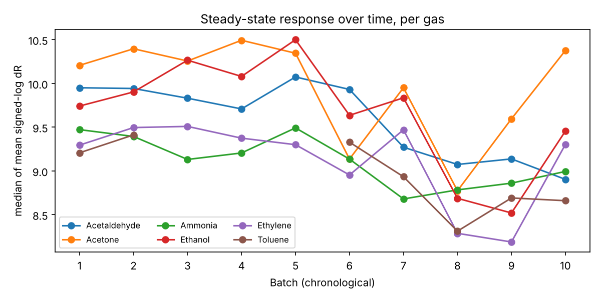
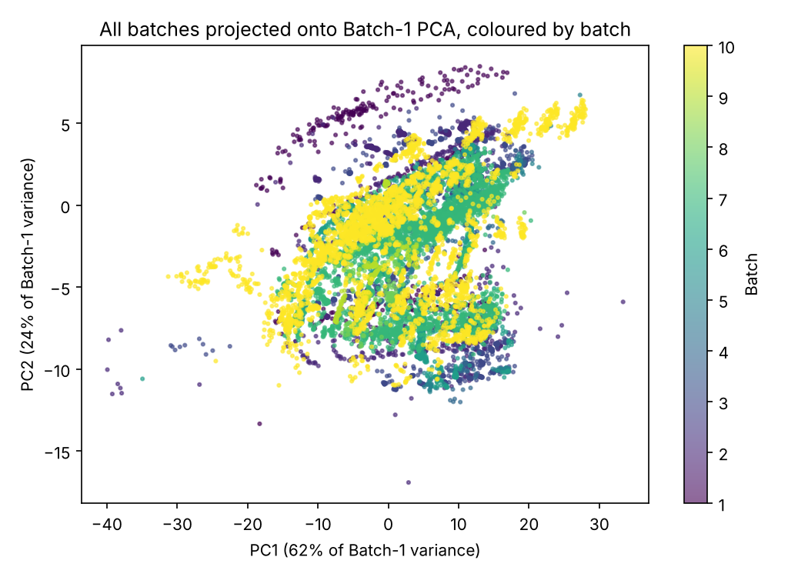
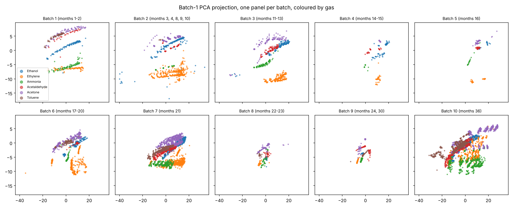

# Data audit: UCI Gas Sensor Array Drift Dataset

Generated by `scripts/audit_data.py` on 2026-11-23. All numbers are
computed from the raw files (`data/raw/Dataset/batch1.dat` to `batch10.dat`).

## 1. Validation checks (all passed)

- Total measurements: **13910** (expected 13,910)
- Features per measurement: **128** (16 sensors x 8 features)
- All values finite; no missing or duplicate feature indices
- Duplicate measurement rows: **0**
- Toluene samples in batches 3, 4, 5: **0, 0, 0** (gap confirmed)

## 2. Batch timeline

| batch | months |
|---|---|
| 1 | 1-2 |
| 2 | 3, 4, 8, 9, 10 |
| 3 | 11-13 |
| 4 | 14-15 |
| 5 | 16 |
| 6 | 17-20 |
| 7 | 21 |
| 8 | 22-23 |
| 9 | 24, 30 |
| 10 | 36 |

## 3. Samples per batch and gas

| batch | Ethanol | Ethylene | Ammonia | Acetaldehyde | Acetone | Toluene | Total |
|---|---|---|---|---|---|---|---|
| 1 | 90 | 98 | 83 | 30 | 70 | 74 | 445 |
| 2 | 164 | 334 | 100 | 109 | 532 | 5 | 1244 |
| 3 | 365 | 490 | 216 | 240 | 275 | 0 | 1586 |
| 4 | 64 | 43 | 12 | 30 | 12 | 0 | 161 |
| 5 | 28 | 40 | 20 | 46 | 63 | 0 | 197 |
| 6 | 514 | 574 | 110 | 29 | 606 | 467 | 2300 |
| 7 | 649 | 662 | 360 | 744 | 630 | 568 | 3613 |
| 8 | 30 | 30 | 40 | 33 | 143 | 18 | 294 |
| 9 | 61 | 55 | 100 | 75 | 78 | 101 | 470 |
| 10 | 600 | 600 | 600 | 600 | 600 | 600 | 3600 |
| Total | 2565 | 2926 | 1641 | 1936 | 3009 | 1833 | 13910 |

Observations for the experimental design:

- Batch 1 (the training period) has only **445** samples.
  The smallest gas there is **Acetaldehyde** with **30** samples.
- Some later batches have very few samples of a gas (e.g. batch 4: Ammonia
  12, Acetone 12). Per-batch metrics for those cells will be noisy.
- Batch 2 contains only **5** toluene samples, so toluene is nearly absent
  from batches 2-5.
- The gas mix changes a lot between batches, so the share of "unfamiliar" samples
  differs per batch. AUPRC must be reported alongside that share.

## 4. Feature value ranges

| feature kind | min | median | max | fraction < 0 |
|---|---|---|---|---|
| dR | -2.37e+04 | 1.14e+04 | 6.71e+05 | 0.00372 |
| dR_norm | 0.0883 | 3.75 | 3.12e+04 | 0 |
| ema_rise_a1 | 0.0001 | 3.47 | 169 | 0 |
| ema_rise_a2 | 0.0001 | 6.54 | 731 | 0 |
| ema_rise_a3 | 0.0001 | 9.8 | 1.2e+04 | 0 |
| ema_decay_a1 | -131 | -2.29 | 0 | 1 |
| ema_decay_a2 | -407 | -3.56 | 22.2 | 1 |
| ema_decay_a3 | -2.95e+03 | -8.56 | 117 | 1 |

- `dR` spans several orders of magnitude and is occasionally negative.
- All `ema_decay` features are (almost) always negative, by construction.
- Implication: some compressive transform (e.g. signed log) is needed before
  scaling, and the fly encoder's non-negative "PN" input must be designed with
  the negative decay features in mind. This is a preprocessing decision for Week 2-3.

## 5. Heavy tails (raw values more than 6 robust SDs from the column median)

| feature kind | flagged values | samples with >=1 flag |
|---|---|---|
| dR | 1532 | 1080 |
| dR_norm | 3727 | 1072 |
| ema_rise_a1 | 1949 | 1123 |
| ema_rise_a2 | 2065 | 1147 |
| ema_rise_a3 | 2281 | 1110 |
| ema_decay_a1 | 2143 | 1149 |
| ema_decay_a2 | 3632 | 1322 |
| ema_decay_a3 | 7239 | 1938 |

| batch | fraction of samples flagged |
|---|---|
| 1 | 0.384 |
| 2 | 0.549 |
| 3 | 0.315 |
| 4 | 0.64 |
| 5 | 0.421 |
| 6 | 0.1 |
| 7 | 0.118 |
| 8 | 0.0238 |
| 9 | 0.00851 |
| 10 | 0.229 |

The flagged fraction is large because raw features are strongly right-skewed:
gases were dosed from 5 to 1000 ppmv, so high-concentration samples sit far
from the median. **These are mostly not measurement errors.** The table says
raw-scale distances are dominated by a few large values, which is another
reason for a compressive transform. Nothing is removed. Any clipping rule
must be fitted on Batch-1 training data only and applied to every model.

## 6. Temporal shift (first look)

Median over samples of the mean signed-log steady-state response across the
16 sensors, computed **within each gas** so the changing gas mix does not
create a false trend:

| batch | Acetaldehyde | Acetone | Ammonia | Ethanol | Ethylene | Toluene |
|---|---|---|---|---|---|---|
| 1 | 9.95 | 10.2 | 9.47 | 9.74 | 9.3 | 9.21 |
| 2 | 9.94 | 10.4 | 9.39 | 9.9 | 9.5 | 9.41 |
| 3 | 9.83 | 10.3 | 9.13 | 10.3 | 9.51 | nan |
| 4 | 9.71 | 10.5 | 9.21 | 10.1 | 9.38 | nan |
| 5 | 10.1 | 10.3 | 9.49 | 10.5 | 9.3 | nan |
| 6 | 9.93 | 9.14 | 9.14 | 9.64 | 8.95 | 9.33 |
| 7 | 9.27 | 9.95 | 8.68 | 9.84 | 9.47 | 8.93 |
| 8 | 9.07 | 8.77 | 8.78 | 8.69 | 8.29 | 8.31 |
| 9 | 9.14 | 9.6 | 8.86 | 8.52 | 8.19 | 8.69 |
| 10 | 8.9 | 10.4 | 8.99 | 9.46 | 9.3 | 8.66 |

All batches projected onto a PCA fitted on Batch 1 only
(PC1 62%, PC2 24% of Batch-1 variance):

**Caution:** batches also differ in gas concentration and sampling schedule
(see Vergara et al. 2012, Tables 1-2). Changes here show *temporal distribution
shift*; they do not by themselves prove sensor ageing.
