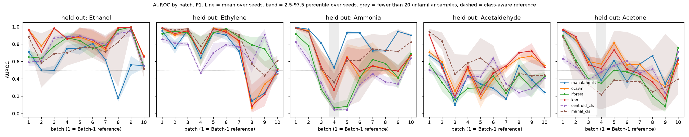
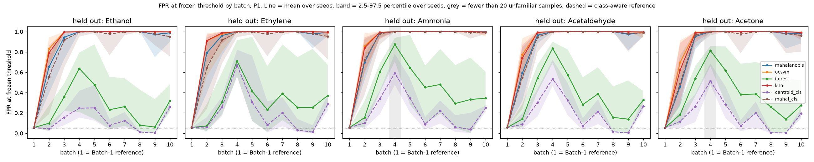
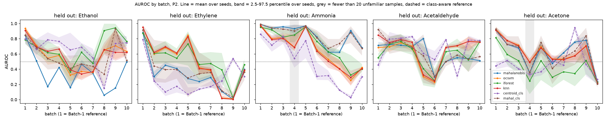
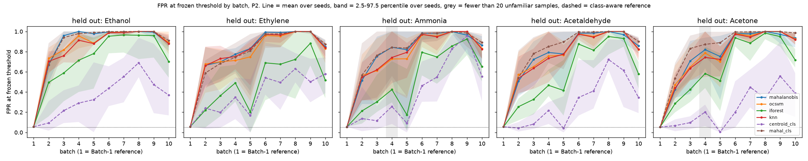

# Phase 2: conventional baseline results

Generated by `scripts/run_baselines.py` on 2026-11-24 (20 seeds, 7.6 min). Every number below is computed from `results/baselines.csv`. No fly model exists yet.

Protocol: train on Batch 1 without the held-out gas (70% FIT / 30% CALIB, seeded), tune by pseudo-novelty inside Batch 1, threshold = 95th percentile of CALIB scores, freeze, test on batches 2-10. Cells show mean ± SD over seeds of the per-seed average over batches 2-10. The SD reflects only FIT/CALIB split randomness (and Isolation Forest's own seed).

Label-free methods are the main comparison for the fly model. Class-aware methods use gas labels and are a stronger reference only.

## P1

### AUROC (0.5 = chance)

| method       | labels      | Ethanol       | Ethylene      | Ammonia       | Acetaldehyde   | Acetone       |   mean over gases |
|:-------------|:------------|:--------------|:--------------|:--------------|:---------------|:--------------|------------------:|
| mahalanobis  | label-free  | 0.579 ± 0.021 | 0.643 ± 0.025 | 0.830 ± 0.006 | 0.344 ± 0.010  | 0.562 ± 0.017 |             0.591 |
| ocsvm        | label-free  | 0.857 ± 0.028 | 0.686 ± 0.025 | 0.552 ± 0.076 | 0.482 ± 0.024  | 0.585 ± 0.022 |             0.632 |
| iforest      | label-free  | 0.796 ± 0.023 | 0.825 ± 0.028 | 0.436 ± 0.035 | 0.326 ± 0.032  | 0.424 ± 0.036 |             0.562 |
| knn          | label-free  | 0.854 ± 0.038 | 0.682 ± 0.033 | 0.567 ± 0.057 | 0.495 ± 0.020  | 0.536 ± 0.033 |             0.627 |
| centroid_cls | class-aware | 0.813 ± 0.012 | 0.700 ± 0.017 | 0.354 ± 0.017 | 0.375 ± 0.012  | 0.500 ± 0.011 |             0.548 |
| mahal_cls    | class-aware | 0.724 ± 0.107 | 0.799 ± 0.081 | 0.672 ± 0.140 | 0.515 ± 0.087  | 0.357 ± 0.294 |             0.614 |

### AUPRC (chance = unfamiliar share; see `data_audit.md` §3a)

| method       | labels      | Ethanol       | Ethylene      | Ammonia       | Acetaldehyde   | Acetone       |   mean over gases |
|:-------------|:------------|:--------------|:--------------|:--------------|:---------------|:--------------|------------------:|
| mahalanobis  | label-free  | 0.259 ± 0.014 | 0.426 ± 0.033 | 0.379 ± 0.010 | 0.129 ± 0.003  | 0.335 ± 0.011 |             0.306 |
| ocsvm        | label-free  | 0.597 ± 0.038 | 0.524 ± 0.018 | 0.170 ± 0.023 | 0.168 ± 0.006  | 0.319 ± 0.013 |             0.356 |
| iforest      | label-free  | 0.506 ± 0.042 | 0.541 ± 0.050 | 0.120 ± 0.010 | 0.106 ± 0.004  | 0.269 ± 0.014 |             0.308 |
| knn          | label-free  | 0.608 ± 0.047 | 0.520 ± 0.017 | 0.168 ± 0.012 | 0.174 ± 0.010  | 0.302 ± 0.020 |             0.354 |
| centroid_cls | class-aware | 0.497 ± 0.034 | 0.390 ± 0.023 | 0.099 ± 0.004 | 0.111 ± 0.001  | 0.271 ± 0.007 |             0.274 |
| mahal_cls    | class-aware | 0.458 ± 0.096 | 0.584 ± 0.084 | 0.247 ± 0.063 | 0.171 ± 0.029  | 0.268 ± 0.159 |             0.346 |

### False-positive rate on familiar gases at the frozen threshold (target in Batch 1: 0.05)

| method       | labels      | Ethanol       | Ethylene      | Ammonia       | Acetaldehyde   | Acetone       |   mean over gases |
|:-------------|:------------|:--------------|:--------------|:--------------|:---------------|:--------------|------------------:|
| mahalanobis  | label-free  | 0.951 ± 0.033 | 0.969 ± 0.035 | 0.965 ± 0.011 | 0.947 ± 0.025  | 0.931 ± 0.027 |             0.953 |
| ocsvm        | label-free  | 0.981 ± 0.010 | 0.987 ± 0.029 | 0.983 ± 0.017 | 0.973 ± 0.018  | 0.965 ± 0.023 |             0.978 |
| iforest      | label-free  | 0.281 ± 0.121 | 0.334 ± 0.172 | 0.464 ± 0.143 | 0.376 ± 0.106  | 0.399 ± 0.119 |             0.371 |
| knn          | label-free  | 0.976 ± 0.008 | 0.988 ± 0.018 | 0.981 ± 0.016 | 0.970 ± 0.014  | 0.956 ± 0.026 |             0.974 |
| centroid_cls | class-aware | 0.130 ± 0.041 | 0.211 ± 0.077 | 0.226 ± 0.058 | 0.202 ± 0.052  | 0.183 ± 0.046 |             0.191 |
| mahal_cls    | class-aware | 0.930 ± 0.054 | 0.940 ± 0.061 | 0.965 ± 0.026 | 0.940 ± 0.037  | 0.930 ± 0.037 |             0.941 |

### Unfamiliar-gas detection rate (TPR) at the frozen threshold

| method       | labels      | Ethanol       | Ethylene      | Ammonia       | Acetaldehyde   | Acetone       |   mean over gases |
|:-------------|:------------|:--------------|:--------------|:--------------|:---------------|:--------------|------------------:|
| mahalanobis  | label-free  | 0.953 ± 0.007 | 0.993 ± 0.009 | 1.000 ± 0.000 | 0.966 ± 0.075  | 0.987 ± 0.026 |             0.98  |
| ocsvm        | label-free  | 1.000 ± 0.000 | 0.998 ± 0.010 | 1.000 ± 0.000 | 0.994 ± 0.006  | 0.997 ± 0.008 |             0.998 |
| iforest      | label-free  | 0.548 ± 0.216 | 0.759 ± 0.153 | 0.301 ± 0.247 | 0.129 ± 0.072  | 0.380 ± 0.146 |             0.423 |
| knn          | label-free  | 1.000 ± 0.000 | 0.999 ± 0.003 | 1.000 ± 0.000 | 0.991 ± 0.012  | 0.996 ± 0.012 |             0.997 |
| centroid_cls | class-aware | 0.374 ± 0.065 | 0.409 ± 0.120 | 0.075 ± 0.025 | 0.071 ± 0.029  | 0.166 ± 0.090 |             0.219 |
| mahal_cls    | class-aware | 0.952 ± 0.048 | 1.000 ± 0.002 | 1.000 ± 0.000 | 0.998 ± 0.002  | 0.872 ± 0.151 |             0.964 |

## P2

### AUROC (0.5 = chance)

| method       | labels      | Ethanol       | Ethylene      | Ammonia       | Acetaldehyde   | Acetone       |   mean over gases |
|:-------------|:------------|:--------------|:--------------|:--------------|:---------------|:--------------|------------------:|
| mahalanobis  | label-free  | 0.309 ± 0.010 | 0.276 ± 0.023 | 0.828 ± 0.011 | 0.594 ± 0.012  | 0.591 ± 0.013 |             0.52  |
| ocsvm        | label-free  | 0.542 ± 0.026 | 0.438 ± 0.014 | 0.616 ± 0.026 | 0.621 ± 0.021  | 0.585 ± 0.020 |             0.561 |
| iforest      | label-free  | 0.665 ± 0.049 | 0.479 ± 0.054 | 0.691 ± 0.032 | 0.598 ± 0.039  | 0.401 ± 0.059 |             0.567 |
| knn          | label-free  | 0.554 ± 0.031 | 0.441 ± 0.015 | 0.609 ± 0.022 | 0.642 ± 0.017  | 0.578 ± 0.027 |             0.565 |
| centroid_cls | class-aware | 0.638 ± 0.038 | 0.221 ± 0.026 | 0.438 ± 0.040 | 0.692 ± 0.016  | 0.472 ± 0.011 |             0.492 |
| mahal_cls    | class-aware | 0.533 ± 0.028 | 0.303 ± 0.125 | 0.835 ± 0.026 | 0.586 ± 0.044  | 0.575 ± 0.078 |             0.566 |

### AUPRC (chance = unfamiliar share; see `data_audit.md` §3a)

| method       | labels      | Ethanol       | Ethylene      | Ammonia       | Acetaldehyde   | Acetone       |   mean over gases |
|:-------------|:------------|:--------------|:--------------|:--------------|:---------------|:--------------|------------------:|
| mahalanobis  | label-free  | 0.153 ± 0.003 | 0.153 ± 0.005 | 0.454 ± 0.025 | 0.203 ± 0.008  | 0.327 ± 0.009 |             0.258 |
| ocsvm        | label-free  | 0.211 ± 0.015 | 0.220 ± 0.008 | 0.232 ± 0.014 | 0.280 ± 0.012  | 0.326 ± 0.015 |             0.254 |
| iforest      | label-free  | 0.389 ± 0.065 | 0.220 ± 0.028 | 0.295 ± 0.039 | 0.249 ± 0.023  | 0.233 ± 0.029 |             0.277 |
| knn          | label-free  | 0.214 ± 0.019 | 0.221 ± 0.008 | 0.228 ± 0.011 | 0.275 ± 0.014  | 0.320 ± 0.018 |             0.252 |
| centroid_cls | class-aware | 0.265 ± 0.030 | 0.138 ± 0.004 | 0.167 ± 0.032 | 0.316 ± 0.010  | 0.280 ± 0.008 |             0.233 |
| mahal_cls    | class-aware | 0.237 ± 0.014 | 0.170 ± 0.048 | 0.423 ± 0.046 | 0.228 ± 0.026  | 0.334 ± 0.054 |             0.278 |

### False-positive rate on familiar gases at the frozen threshold (target in Batch 1: 0.05)

| method       | labels      | Ethanol       | Ethylene      | Ammonia       | Acetaldehyde   | Acetone       |   mean over gases |
|:-------------|:------------|:--------------|:--------------|:--------------|:---------------|:--------------|------------------:|
| mahalanobis  | label-free  | 0.941 ± 0.029 | 0.866 ± 0.053 | 0.858 ± 0.110 | 0.844 ± 0.076  | 0.841 ± 0.065 |             0.87  |
| ocsvm        | label-free  | 0.918 ± 0.027 | 0.842 ± 0.074 | 0.821 ± 0.085 | 0.832 ± 0.062  | 0.830 ± 0.059 |             0.849 |
| iforest      | label-free  | 0.791 ± 0.106 | 0.529 ± 0.155 | 0.565 ± 0.096 | 0.624 ± 0.066  | 0.698 ± 0.068 |             0.641 |
| knn          | label-free  | 0.901 ± 0.026 | 0.861 ± 0.058 | 0.828 ± 0.076 | 0.825 ± 0.066  | 0.820 ± 0.054 |             0.847 |
| centroid_cls | class-aware | 0.383 ± 0.135 | 0.411 ± 0.153 | 0.438 ± 0.105 | 0.313 ± 0.100  | 0.256 ± 0.105 |             0.36  |
| mahal_cls    | class-aware | 0.943 ± 0.032 | 0.849 ± 0.064 | 0.873 ± 0.097 | 0.885 ± 0.056  | 0.901 ± 0.048 |             0.89  |

### Unfamiliar-gas detection rate (TPR) at the frozen threshold

| method       | labels      | Ethanol       | Ethylene      | Ammonia       | Acetaldehyde   | Acetone       |   mean over gases |
|:-------------|:------------|:--------------|:--------------|:--------------|:---------------|:--------------|------------------:|
| mahalanobis  | label-free  | 0.879 ± 0.077 | 0.860 ± 0.130 | 0.996 ± 0.008 | 0.955 ± 0.049  | 0.925 ± 0.067 |             0.923 |
| ocsvm        | label-free  | 0.990 ± 0.029 | 0.964 ± 0.047 | 0.996 ± 0.013 | 0.945 ± 0.079  | 0.933 ± 0.027 |             0.966 |
| iforest      | label-free  | 0.883 ± 0.102 | 0.544 ± 0.289 | 0.894 ± 0.043 | 0.727 ± 0.099  | 0.582 ± 0.112 |             0.726 |
| knn          | label-free  | 0.998 ± 0.002 | 0.970 ± 0.030 | 0.993 ± 0.014 | 0.975 ± 0.049  | 0.916 ± 0.034 |             0.97  |
| centroid_cls | class-aware | 0.557 ± 0.238 | 0.123 ± 0.092 | 0.267 ± 0.191 | 0.450 ± 0.163  | 0.224 ± 0.073 |             0.324 |
| mahal_cls    | class-aware | 0.981 ± 0.024 | 0.763 ± 0.168 | 0.997 ± 0.006 | 0.975 ± 0.054  | 0.951 ± 0.024 |             0.934 |

## Batch-1 reference AUROC (CALIB familiar vs Batch-1 held-out gas, no drift)

|                        |   Ethanol |   Ethylene |   Ammonia |   Acetaldehyde |   Acetone |
|:-----------------------|----------:|-----------:|----------:|---------------:|----------:|
| ('P1', 'centroid_cls') |     0.592 |      0.857 |     0.827 |          0.503 |     0.632 |
| ('P1', 'iforest')      |     0.652 |      0.921 |     0.918 |          0.57  |     0.902 |
| ('P1', 'knn')          |     0.966 |      0.985 |     0.988 |          0.909 |     0.967 |
| ('P1', 'mahal_cls')    |     0.885 |      0.982 |     0.991 |          0.944 |     0.887 |
| ('P1', 'mahalanobis')  |     0.713 |      0.952 |     0.993 |          0.67  |     0.955 |
| ('P1', 'ocsvm')        |     0.966 |      0.984 |     0.988 |          0.708 |     0.968 |
| ('P2', 'centroid_cls') |     0.797 |      0.789 |     0.861 |          0.456 |     0.444 |
| ('P2', 'iforest')      |     0.786 |      0.873 |     0.952 |          0.552 |     0.815 |
| ('P2', 'knn')          |     0.909 |      0.951 |     0.971 |          0.848 |     0.911 |
| ('P2', 'mahal_cls')    |     0.846 |      0.913 |     0.99  |          0.921 |     0.925 |
| ('P2', 'mahalanobis')  |     0.844 |      0.881 |     0.989 |          0.712 |     0.913 |
| ('P2', 'ocsvm')        |     0.935 |      0.951 |     0.977 |          0.685 |     0.925 |

## Most frequently chosen configs (count over held-out gases x seeds)

|                   | config                                                                                                                                             |
|:------------------|:---------------------------------------------------------------------------------------------------------------------------------------------------|
| ('iforest', 'P1') | {"{'max_samples': 256, 'max_features': 0.5}": 53, "{'max_samples': 256, 'max_features': 1.0}": 47}                                                 |
| ('iforest', 'P2') | {"{'max_samples': 256, 'max_features': 1.0}": 50, "{'max_samples': 256, 'max_features': 0.5}": 46, "{'max_samples': 128, 'max_features': 1.0}": 3} |
| ('knn', 'P1')     | {"{'k': 1}": 74, "{'k': 3}": 17, "{'k': 5}": 9}                                                                                                    |
| ('knn', 'P2')     | {"{'k': 1}": 97, "{'k': 3}": 3}                                                                                                                    |
| ('ocsvm', 'P1')   | {"{'nu': 0.01, 'gamma_mult': 10.0}": 48, "{'nu': 0.05, 'gamma_mult': 10.0}": 31, "{'nu': 0.2, 'gamma_mult': 10.0}": 11}                            |
| ('ocsvm', 'P2')   | {"{'nu': 0.01, 'gamma_mult': 10.0}": 39, "{'nu': 0.05, 'gamma_mult': 10.0}": 27, "{'nu': 0.1, 'gamma_mult': 10.0}": 22}                            |
