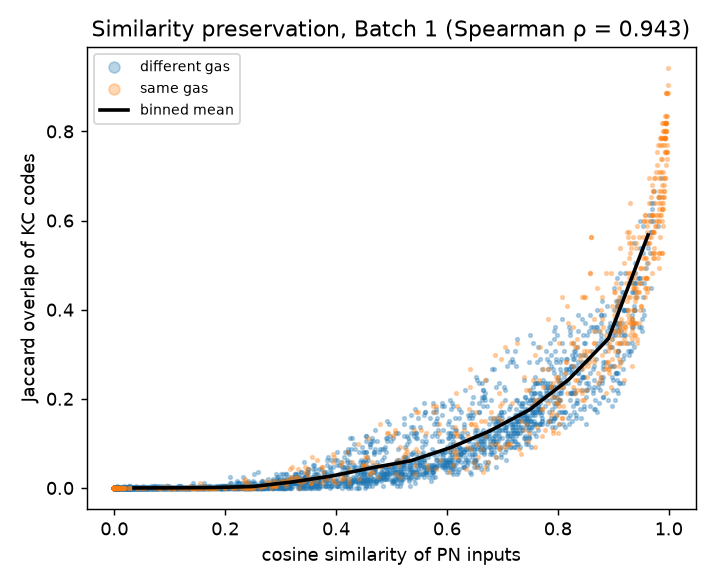
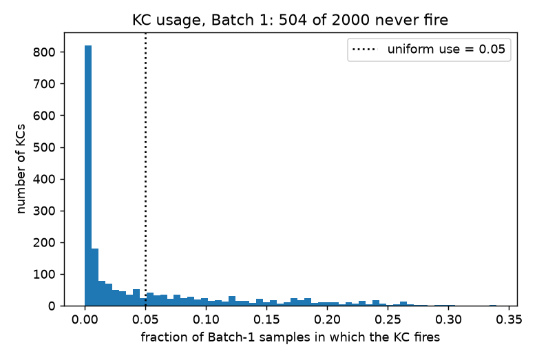
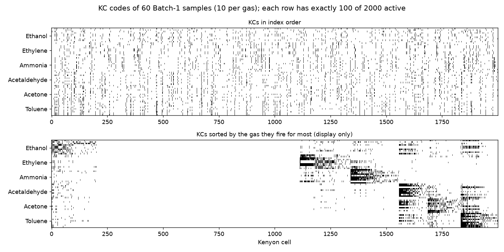
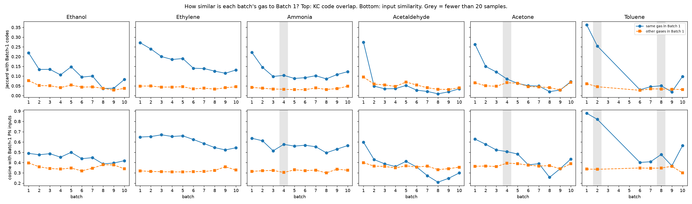

# Phase 3: encoder diagnostics

Generated by `scripts/encoder_diagnostics.py` on 2026-11-24. Encoder: m = 2000 KCs, s = 6 inputs per KC, k = 100 active (5%), ON/OFF PN input (256 channels), seed 0. P1 preprocessing fitted on all Batch-1 rows. Diagnostic only, no detection results.

## 1. Structural checks

- Active KCs per sample: min 100, max 100 (expected exactly 100) over all 13910 samples
- Non-zero PN channels per sample: mean 128.0 of 256 (ON/OFF: at most 128 can be non-zero)
- Effective fan-in (distinct features per KC): mean 5.95; 5.1% of KCs are wired to both the ON and OFF channel of at least one feature

## 2. Similarity preservation

3993 random Batch-1 pairs: Spearman ρ(input cosine, code Jaccard) = **0.943**. Random-code chance Jaccard ≈ 0.026.

## 3. KC usage (lifetime sparsity)

- Batch 1: **504** of 2000 KCs never fire (25.2%); all batches: 181.
- Dead KCs in Batch 1 for seeds 0-4: [504, 461, 482, 500, 479]
- KCs firing in more than 50% of Batch-1 samples: 0
- Max firing rate of one KC in Batch 1: 0.34

## 4. Raster

## 5. Overlap with Batch-1 codes over time

For each gas and batch: mean similarity of that batch's samples to Batch-1 samples of the **same** gas vs. of **other** gases (up to 300 samples per cell). A negative code margin means the gas now looks more like other gases' Batch-1 codes than its own.

| gas | batch | n | code same | code other | margin | input same | input other |
|---|---|---|---|---|---|---|---|
| Ethanol | 1 | 90 | 0.220 | 0.077 | +0.142 | 0.489 | 0.397 |
| Ethanol | 2 | 164 | 0.134 | 0.052 | +0.083 | 0.476 | 0.359 |
| Ethanol | 3 | 300 | 0.135 | 0.051 | +0.084 | 0.487 | 0.343 |
| Ethanol | 4 | 64 | 0.106 | 0.041 | +0.065 | 0.452 | 0.337 |
| Ethanol | 5 | 28 | 0.148 | 0.054 | +0.094 | 0.500 | 0.347 |
| Ethanol | 6 | 300 | 0.095 | 0.044 | +0.051 | 0.438 | 0.320 |
| Ethanol | 7 | 300 | 0.100 | 0.045 | +0.056 | 0.448 | 0.346 |
| Ethanol | 8 | 30 | 0.037 | 0.038 | -0.001 | 0.387 | 0.379 |
| Ethanol | 9 | 61 | 0.038 | 0.028 | +0.010 | 0.395 | 0.378 |
| Ethanol | 10 | 300 | 0.083 | 0.037 | +0.045 | 0.418 | 0.339 |
| Ethylene | 1 | 98 | 0.271 | 0.049 | +0.222 | 0.648 | 0.320 |
| Ethylene | 2 | 300 | 0.239 | 0.049 | +0.190 | 0.653 | 0.314 |
| Ethylene | 3 | 300 | 0.200 | 0.044 | +0.156 | 0.670 | 0.311 |
| Ethylene | 4 | 43 | 0.185 | 0.044 | +0.141 | 0.654 | 0.310 |
| Ethylene | 5 | 40 | 0.190 | 0.046 | +0.145 | 0.660 | 0.309 |
| Ethylene | 6 | 300 | 0.140 | 0.035 | +0.106 | 0.624 | 0.312 |
| Ethylene | 7 | 300 | 0.139 | 0.038 | +0.100 | 0.585 | 0.313 |
| Ethylene | 8 | 30 | 0.126 | 0.033 | +0.093 | 0.546 | 0.324 |
| Ethylene | 9 | 55 | 0.115 | 0.041 | +0.074 | 0.523 | 0.359 |
| Ethylene | 10 | 300 | 0.132 | 0.045 | +0.086 | 0.544 | 0.328 |
| Ammonia | 1 | 83 | 0.222 | 0.042 | +0.180 | 0.636 | 0.315 |
| Ammonia | 2 | 100 | 0.145 | 0.038 | +0.107 | 0.612 | 0.321 |
| Ammonia | 3 | 216 | 0.098 | 0.034 | +0.064 | 0.515 | 0.324 |
| Ammonia | 4 | 12 | 0.104 | 0.033 | +0.071 | 0.577 | 0.304 |
| Ammonia | 5 | 20 | 0.088 | 0.031 | +0.058 | 0.560 | 0.330 |
| Ammonia | 6 | 110 | 0.092 | 0.031 | +0.061 | 0.569 | 0.322 |
| Ammonia | 7 | 300 | 0.102 | 0.039 | +0.063 | 0.554 | 0.327 |
| Ammonia | 8 | 40 | 0.086 | 0.032 | +0.054 | 0.495 | 0.300 |
| Ammonia | 9 | 100 | 0.108 | 0.036 | +0.072 | 0.531 | 0.336 |
| Ammonia | 10 | 300 | 0.123 | 0.048 | +0.075 | 0.565 | 0.325 |
| Acetaldehyde | 1 | 30 | 0.274 | 0.095 | +0.179 | 0.599 | 0.399 |
| Acetaldehyde | 2 | 109 | 0.048 | 0.059 | -0.011 | 0.429 | 0.366 |
| Acetaldehyde | 3 | 240 | 0.035 | 0.055 | -0.020 | 0.388 | 0.363 |
| Acetaldehyde | 4 | 30 | 0.036 | 0.047 | -0.012 | 0.361 | 0.349 |
| Acetaldehyde | 5 | 46 | 0.052 | 0.070 | -0.017 | 0.412 | 0.368 |
| Acetaldehyde | 6 | 29 | 0.028 | 0.054 | -0.026 | 0.357 | 0.357 |
| Acetaldehyde | 7 | 300 | 0.021 | 0.040 | -0.019 | 0.273 | 0.366 |
| Acetaldehyde | 8 | 33 | 0.009 | 0.033 | -0.023 | 0.210 | 0.332 |
| Acetaldehyde | 9 | 75 | 0.019 | 0.031 | -0.012 | 0.247 | 0.341 |
| Acetaldehyde | 10 | 300 | 0.035 | 0.040 | -0.005 | 0.299 | 0.355 |
| Acetone | 1 | 70 | 0.262 | 0.066 | +0.196 | 0.628 | 0.364 |
| Acetone | 2 | 300 | 0.149 | 0.050 | +0.099 | 0.577 | 0.367 |
| Acetone | 3 | 275 | 0.121 | 0.048 | +0.073 | 0.523 | 0.362 |
| Acetone | 4 | 12 | 0.085 | 0.066 | +0.019 | 0.506 | 0.394 |
| Acetone | 5 | 63 | 0.063 | 0.064 | -0.001 | 0.483 | 0.389 |
| Acetone | 6 | 300 | 0.051 | 0.047 | +0.004 | 0.378 | 0.375 |
| Acetone | 7 | 300 | 0.049 | 0.045 | +0.004 | 0.389 | 0.367 |
| Acetone | 8 | 143 | 0.020 | 0.041 | -0.021 | 0.257 | 0.370 |
| Acetone | 9 | 78 | 0.029 | 0.029 | -0.000 | 0.341 | 0.340 |
| Acetone | 10 | 300 | 0.072 | 0.069 | +0.004 | 0.435 | 0.389 |
| Toluene | 1 | 74 | 0.363 | 0.061 | +0.301 | 0.879 | 0.337 |
| Toluene | 2 | 5 | 0.254 | 0.046 | +0.209 | 0.820 | 0.335 |
| Toluene | 6 | 300 | 0.030 | 0.027 | +0.003 | 0.401 | 0.348 |
| Toluene | 7 | 300 | 0.046 | 0.035 | +0.011 | 0.408 | 0.345 |
| Toluene | 8 | 18 | 0.050 | 0.034 | +0.016 | 0.479 | 0.347 |
| Toluene | 9 | 101 | 0.019 | 0.032 | -0.013 | 0.368 | 0.364 |
| Toluene | 10 | 300 | 0.098 | 0.031 | +0.067 | 0.564 | 0.300 |
