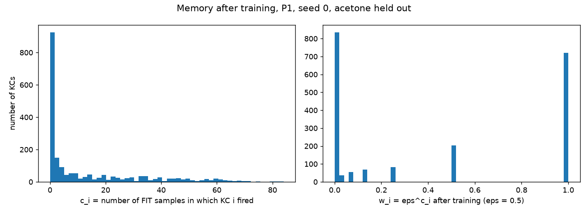
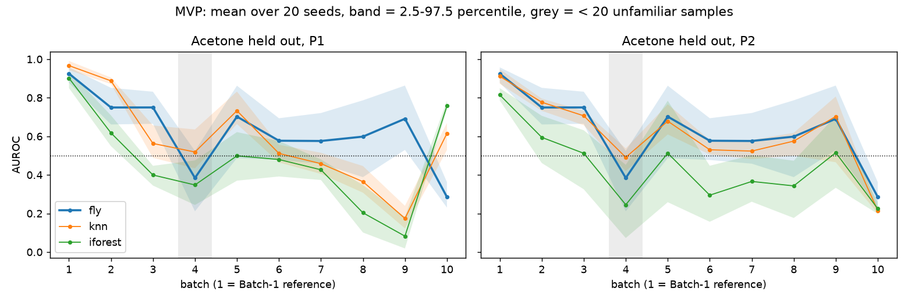

# Phase 3 MVP: fly model vs kNN and Isolation Forest, acetone held out

Generated by `scripts/run_mvp.py` on 2026-11-24. 20 seeds. Fly = ON/OFF PN input, m = 2000, s = 6, k = 100, memory w = eps^count, eps tuned by pseudo-novelty over [0.5, 0.8, 0.9, 0.95, 0.99]. Same splits, tuning rule and threshold rule as the baselines. **One gas only; this is a pipeline check, not a project result.**

## Mean over batches 2-10 (mean ± SD over seeds)

| prep | method | AUROC | AUPRC | FPR at θ | TPR at θ |
|---|---|---|---|---|---|
| P1 | fly | 0.590 ± 0.048 | 0.328 ± 0.042 | 0.789 ± 0.069 | 0.908 ± 0.098 |
| P1 | iforest | 0.424 ± 0.036 | 0.269 ± 0.014 | 0.399 ± 0.119 | 0.380 ± 0.146 |
| P1 | knn | 0.536 ± 0.033 | 0.302 ± 0.020 | 0.956 ± 0.026 | 0.996 ± 0.012 |
| P2 | fly | 0.590 ± 0.048 | 0.328 ± 0.042 | 0.789 ± 0.069 | 0.908 ± 0.098 |
| P2 | iforest | 0.401 ± 0.059 | 0.233 ± 0.029 | 0.698 ± 0.068 | 0.582 ± 0.112 |
| P2 | knn | 0.578 ± 0.027 | 0.320 ± 0.018 | 0.820 ± 0.054 | 0.916 ± 0.034 |

## Paired AUROC difference (fly minus baseline, same seed and split)

| prep | baseline | mean diff | seeds favouring fly |
|---|---|---|---|
| P1 | knn | +0.054 | 15 / 20 |
| P1 | iforest | +0.167 | 20 / 20 |
| P2 | knn | +0.013 | 12 / 20 |
| P2 | iforest | +0.189 | 20 / 20 |

## AUROC per batch, P1 (mean over seeds; batch 1 = Batch-1 reference)

| method   |     1 |     2 |     3 |     4 |     5 |     6 |     7 |     8 |     9 |    10 |
|:---------|------:|------:|------:|------:|------:|------:|------:|------:|------:|------:|
| fly      | 0.925 | 0.749 | 0.75  | 0.384 | 0.702 | 0.577 | 0.576 | 0.598 | 0.691 | 0.285 |
| iforest  | 0.902 | 0.618 | 0.399 | 0.348 | 0.499 | 0.48  | 0.426 | 0.204 | 0.082 | 0.758 |
| knn      | 0.967 | 0.888 | 0.563 | 0.519 | 0.733 | 0.511 | 0.458 | 0.365 | 0.174 | 0.615 |

## Memory saturation (P1, seed 0)

- Chosen eps over all 40 runs: {0.5: 34, 0.8: 6}
- Seed 0: eps = 0.5; KCs with w = 1 (never used): 36.0%; w < 0.01 (saturated): 39.6%; median count among used KCs: 13

## Go/no-go (bars fixed before the run)

| check | result | pass |
|---|---|---|
| G1 leakage tests | run `pytest` (fly perturbation test included) | see test output |
| G2 both classes in every test batch | True | ✅ |
| G3 exactly k active; dead KCs in FIT < 50% | max dead = 36.0% | ✅ |
| G4 seed SD of mean AUROC ≤ 0.05 | P1: 0.048, P2: 0.048 | ✅ |

